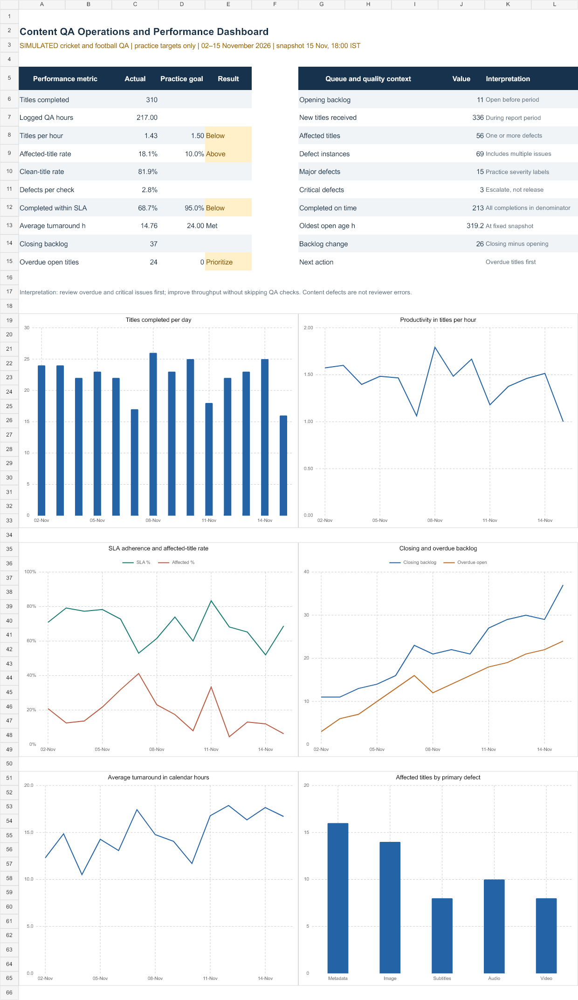

# Content QA Operations and Performance Dashboard

Project 3 is an AI-assisted, independent Excel portfolio simulation aligned to the operations-metric themes of Amazon DSC Associate – Prime Video Sports, requested Job ID 10598698. **Every task, team, reviewer, timestamp, working hour and defect is simulated. No Amazon records or live sports streams were tested.** This is not an Amazon project or employment experience.

## Open and explore

1. Open [Content_QA_Operations_Dashboard.xlsx](Content_QA_Operations_Dashboard.xlsx) in desktop Excel. No macros, external connections or refresh credentials are required.
2. Start on Dashboard for KPIs and six native, editable charts. Read Guide for definitions and practice assumptions.
3. Follow Daily for the arithmetic, including daily queue flow, sport/reviewer summaries, defect categories and aging buckets.
4. Filter Queue to QA status = Open and Overdue flag = 1 for the simulated triage list. Severity columns describe detected content issues; a completed QA task may still require separate remediation.
5. Read [SOP.md](SOP.md), [METRIC_DEFINITIONS.md](METRIC_DEFINITIONS.md) and [RESUME_AND_INTERVIEW.md](RESUME_AND_INTERVIEW.md) before presenting the project.

## Simulated baseline

The dataset contains 352 unique title tasks and 56 daily reviewer-hour records, with four fictional reviewers. The report covers 2–15 November 2026, through 18:00 IST on the final day. The earlier history includes 16 tasks: five completed before the period and 11 forming opening backlog. There are 336 new receipts in the period.

| Metric | Verified simulated value |
| --- | ---: |
| Titles completed during period | 310 |
| Logged QA hours | 217.00 |
| Titles per hour | 1.43 |
| Titles with at least one defect | 56 / 310 |
| Affected-title rate | 18.06% |
| Clean-title rate | 81.94% |
| Defect instances per check | 69 / 2480 = 2.78% |
| Completed within SLA | 213 / 310 = 68.71% |
| Average elapsed turnaround | 14.76 hours |
| Closing backlog | 37 titles |
| Overdue open backlog | 24 titles |

Queue reconciliation: **11 opening + 336 arrivals − 310 completions = 37 closing**. Ending backlog is a snapshot; daily backlog counts must not be added together. The average TAT and rates are weighted from underlying counts, not simple averages of daily percentages.

## What this dashboard says

The simulated queue builds by 26 titles. Twenty-four open items are overdue, and SLA adherence misses the illustrative 95% goal. There are 15 major and three critical defect instances among completed QA tasks; completion means a QA decision was recorded, not that defective content was released. The simulation provides a realistic triage discussion rather than a manufactured success story.

Prioritize overdue/high-impact titles, separate defect remediation from new-review work, and investigate the 7 and 11 November affected-title spikes. Consider whether arrivals exceed practical capacity. Do not raise throughput by skipping checks or attributing all detected content defects to reviewers.

All goals—1.50 titles/hour, affected-title rate at most 10%, SLA at least 95%, TAT at most 24 hours, and asset SLAs of 8/24/48 hours—are **practice choices, not Amazon benchmarks**. Targets can be edited in amber Guide cells. Snapshot/period dates are fixed for this completed exercise; changing the reporting period requires extending/revalidating Daily dates and updating the dashboard caption.

## Included files

- Excel workbook: five sheets, formula-driven KPIs and daily summaries, six native charts, filters, status formatting, validations and reserved input capacity.
- data/: clearly labelled raw CSV inputs, generation manifest and baseline metrics JSON.
- preview/Dashboard.png: the final dashboard preview.
- SOP.md: repeatable capture, triage, reporting and escalation steps.
- METRIC_DEFINITIONS.md: formulas, denominators, assumptions and data dictionary.
- RESUME_AND_INTERVIEW.md: honest resume copy, a walkthrough, questions and scenario answers.
- SOURCES_AND_PROVENANCE.md: role alignment, job-page availability, simulation and AI assistance.
- VALIDATION.md and validation/: independent readback results and saved calculation/input-change checks.
- SHA256SUMS.txt: integrity hashes for every other delivered file.

## Update limits

The workbook has formulas for 500 task rows (Queue 5:504) and 100 hour-log rows (Hours 5:104). Add inputs in the next reserved row without overwriting formula columns G or O:V. Record one work-log row per date/reviewer. The current fixed report is 14 calendar days. Beyond the reserved capacity, extend formulas, table/range boundaries and validations, then rerun reconciliation; automatic unlimited expansion is not claimed.

Filtering Queue helps inspect records; it does **not** change dashboard totals. Dashboard totals always cover the complete reporting period. Reviewer productivity uses all logged QA hours, including documentation and open-task work; it is not average speed per completed clip and is unsuitable for a simplistic reviewer ranking.

Formula results, chart bindings and source data were verified in the authoring engine and the saved XLSX was independently reopened. Native desktop Excel interaction/recalculation was not available in this session; that specific engine check is not claimed. Full details are in VALIDATION.md. No real content/media quality, Amazon SLA compliance or operational improvement is claimed.

## GitHub use

Extract this folder into a repository and retain relative paths. GitHub displays these Markdown/CSV files and the PNG preview directly. Download the XLSX for editing. Published at https://github.com/tharunkumaran11/content-qa-operations-dashboard at the user’s request. No credentials, personal employee data or proprietary content are included. Do not describe simulated results as actual employment achievements.
